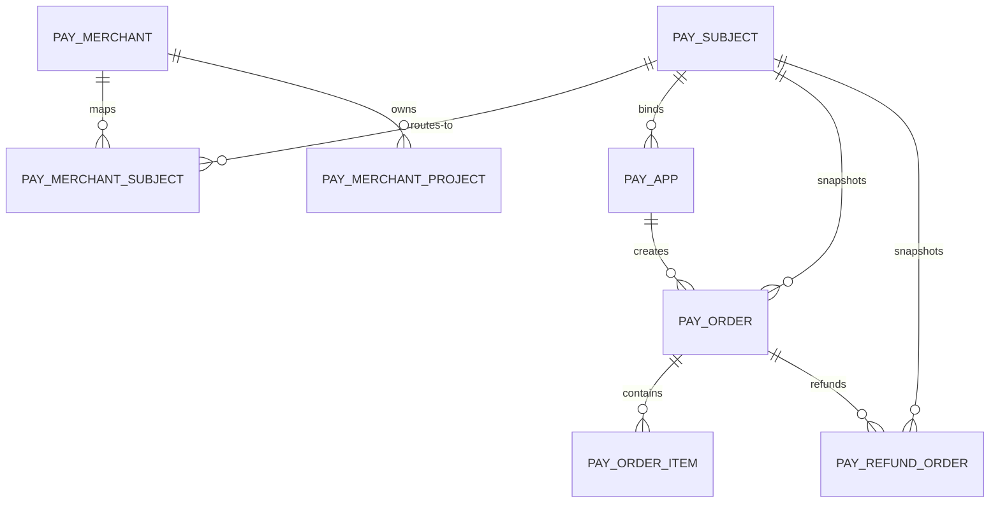

# paycenter S2.5 多支付主体库表设计

> 首筑支付中心 v1.0 一期增补（S2.5）。银商侧一个支付主体（APP / 公众号 / 小程序 / H5）= 一个主商户号；经该主体收款的物业公司为其下子商户。
> 设计基线：`docs/schema/paycenter-schema.md`（S1，已 applied，14 表）+ 银联通道（S2）实现。
> 输入：用户 2026-10-20 收敛确认（cred=per_subject / route=by_app / sub=mapping / scene=APP+WECHAT_MP+MINI_PROGRAM+H5 / order=before_s3）。
> 迁移建议：`backend/.../flyway/sql/mysql/V20261021_1__paycenter_s25_subject.sql`（DDL 仅在 `$apt-schema-apply` 生成，本文为设计稿）。

## 变更摘要

- 新建表（2）：`pay_subject`、`pay_merchant_subject`
- 变更表（6）：
  - `pay_merchant`：下线 `unionpay_mchnt_no` / `unionpay_term_no` / `wx_sub_appid`
  - `pay_merchant_project`：下线 `unionpay_mchnt_no` / `unionpay_term_no`
  - `pay_channel_config`：降级为环境级，下线凭证列 `app_id` / `app_key_enc` / `comm_key_enc` / `msg_src` / `msg_src_id` / `notify_sign_type` / `key_version`（迁入 `pay_subject`）；唯一键 `uk(channel_code)` → `uk(channel_code, env)`
  - `pay_app`：新增 `subject_id`（一个应用绑定一个主体）
  - `pay_order` / `pay_refund_order`：新增 `subject_id` 快照
- 字典：新增 `pay_scene`（APP / WECHAT_MP / MINI_PROGRAM / H5），复用 Jeecg `sys_dict` / `sys_dict_item`
- 实体处置：`pay_subject=create`、`pay_merchant_subject=create`、`pay_merchant=alter`、`pay_merchant_project=alter`、`pay_channel_config=alter`、`pay_app=alter`、`pay_order=alter`、`pay_refund_order=alter`、其余 8 张 S1 表 `reuse` 不动
- 所有下线字段所在表当前 0 行数据，无数据迁移；保留 `pay_order.unionpay_mchnt_no/term_no` 历史快照列不变（下单时解析到的子商户号仍落快照）

## 表清单

### 表 `pay_subject`

- 表名：`pay_subject`
- 处置：create
- 说明：支付主体（一个主商户号 + 该 scene 下的一套银商凭证）。主商户号为主体级，向下的子商户号映射在 `pay_merchant_subject`。
- 主键：`id`
- 索引：`uk_pay_subject_subject_code`(subject_code)、`idx_pay_subject_scene_status`(scene, status)、`idx_pay_subject_channel_code`(channel_code)

| 字段名 | 类型 | 可空 | 说明 |
|--------|------|------|------|
| （公共字段） | — | — | id / create_by / create_time / update_by / update_time，见通用约定 |
| subject_code | VARCHAR(32) | NO | 主体编码，唯一，创建后不可改（如 YL_APP_MAIN） |
| subject_name | VARCHAR(128) | NO | 主体名称（如：银联-APP 主体） |
| scene | VARCHAR(32) | NO | 支付场景，字典 pay_scene：APP / WECHAT_MP / MINI_PROGRAM / H5 |
| channel_code | VARCHAR(32) | NO | 所属通道编码，默认 UNIONPAY |
| main_mchnt_no | VARCHAR(32) | NO | 主商户号（银商 mchnt，本主体收款主账号） |
| main_term_no | VARCHAR(32) | NO | 主终端号 |
| app_id | VARCHAR(64) | NO | 银联开放平台 AppId（原 pay_channel_config 迁入） |
| app_key_enc | VARCHAR(512) | NO | AppKey 密文（AES-256-GCM，原 pay_channel_config 迁入） |
| comm_key_enc | VARCHAR(512) | NO | 通讯密钥密文（通知验签用，原 pay_channel_config 迁入） |
| msg_src | VARCHAR(64) | YES | 消息来源 |
| msg_src_id | VARCHAR(8) | YES | 来源编号（商户订单号前缀，单号生成器取此值） |
| notify_sign_type | VARCHAR(16) | NO DEFAULT 'SHA256' | 通知签名算法 |
| key_version | INT | NO DEFAULT 1 | 主密钥版本（支持轮换） |
| wx_sub_appid | VARCHAR(64) | YES | 主体的微信 appid（WECHAT_MP / MINI_PROGRAM 场景；APP/H5 可空） |
| status | TINYINT(1) | NO DEFAULT 1 | 1=启用 0=停用 |
| remark | VARCHAR(512) | YES | 备注 |
| del_flag | TINYINT(1) | NO DEFAULT 0 | 逻辑删除（配置类表） |

公共审计字段同 S1 约定：`id VARCHAR(32)` 雪花 / `create_by` / `create_time` / `update_by` / `update_time` / `del_flag`。

### 表 `pay_merchant_subject`

- 表名：`pay_merchant_subject`
- 处置：create
- 说明：商户 × 主体（× 小区）子商户号映射。`project_id=''` 表示商户默认映射；小区优先解析（先按 project_id 命中，缺省回落商户默认）。
- 主键：`id`
- 索引：`uk_pay_merchant_subject_msp`(merchant_id, subject_id, project_id)、`idx_pay_merchant_subject_subject`(subject_id)、`idx_pay_merchant_subject_merchant`(merchant_id, status)
- 处置细则：物理删除（同 `pay_merchant_project` 惯例），删除/变更写 `pay_admin_log.diff` 留痕

| 字段名 | 类型 | 可空 | 说明 |
|--------|------|------|------|
| id | VARCHAR(32) | NO | 主键，雪花 ID |
| merchant_id | VARCHAR(32) | NO | pay_merchant.id |
| subject_id | VARCHAR(32) | NO | pay_subject.id |
| project_id | VARCHAR(64) | NO DEFAULT '' | 小区 ID；'' = 商户默认映射（见待评审要点 1） |
| sub_mchnt_no | VARCHAR(32) | NO | 子商户号（物业公司在该主体下备案的银商子商户号） |
| sub_term_no | VARCHAR(32) | YES | 子终端号，空=用主终端号 |
| status | TINYINT(1) | NO DEFAULT 1 | 1=启用 0=停用 |
| create_by | VARCHAR(32) | YES | 创建人 |
| create_time | DATETIME | NO | 创建时间 |
| update_by | VARCHAR(32) | YES | 更新人 |
| update_time | DATETIME | YES | 更新时间 |

不设 `del_flag`（关联映射表物理删除，与 `pay_merchant_project` 一致）。

## 变更表（alter）

### `pay_app`（alter：新增 1 列）

| 字段名 | 类型 | 可空 | 说明 |
|--------|------|------|------|
| subject_id | VARCHAR(32) | NO | 绑定主体 pay_subject.id；下单接口不加 subjectCode 入参，订单主体由调用方应用决定 |

索引：新增 `idx_pay_app_subject_id`(subject_id)。

### `pay_order`（alter：新增 1 列）

| 字段名 | 类型 | 可空 | 说明 |
|--------|------|------|------|
| subject_id | VARCHAR(32) | NO | 下单时解析到的主体快照；查单/退款/关单/退款查询/通知验签按此快照取主体凭证 |

索引：新增 `idx_pay_order_subject_id`(subject_id)。

### `pay_refund_order`（alter：新增 1 列）

| 字段名 | 类型 | 可空 | 说明 |
|--------|------|------|------|
| subject_id | VARCHAR(32) | NO | 退款所属主体快照（同原支付单） |

索引：新增 `idx_pay_refund_order_subject_id`(subject_id)。

### `pay_merchant`（alter：下线 3 列，掉到 pay_subject / pay_merchant_subject）

- 删除列：`unionpay_mchnt_no`、`unionpay_term_no`、`wx_sub_appid`
- 依据：主体模型下主商户号属主体、子商户号属映射，商户不再直挂银商号段；表 0 行无数据迁移

### `pay_merchant_project`（alter：下线 2 列）

- 删除列：`unionpay_mchnt_no`、`unionpay_term_no`

### `pay_channel_config`（alter：降级为环境级）

- 删除列（迁入 pay_subject）：`app_id`、`app_key_enc`、`comm_key_enc`、`msg_src`、`msg_src_id`、`notify_sign_type`、`key_version`
- 保留列：`channel_code`、`env`（TEST/PROD）、`api_base_url`、`backup_base_urls`、`connect_timeout_ms`、`read_timeout_ms`、`rate_limit_tps`、`status`、`remark`、审计与 `del_flag`
- 唯一键调整：`uk_pay_channel_config_channel_code(channel_code)` → `uk_pay_channel_config_channel_env(channel_code, env)`（依据：环境级配置允许每通道按环境一行；原 uk 与多环境互斥，见待评审要点 2）

## 字典（复用 sys_dict）

新增字典 `pay_scene`（系统字典 pc_dict_pay_scene），4 项：

| item_value | item_text | 排序 |
|------------|-----------|------|
| APP | APP 应用 | 1 |
| WECHAT_MP | 微信公众号 | 2 |
| MINI_PROGRAM | 微信小程序 | 3 |
| H5 | H5 | 4 |

S2 适配相关：`PayChannelConfigService.getActive(channel)` 改为按 subjectId 取运行时配置（环境级 + 主体级合并、缓存、失效）；`Channel*Request` 增 subjectId；通知验签定位主体顺序 = 订单号查单 → 订单号前 4 位 msg_src_id 匹配 → 失败即验签失败；单号来源编号改取主体 `msg_src_id`。env bootstrap（PAY_UNIONPAY_APP_ID 等）处置（仅本地默认主体引导或移除）由执行体在 spec 中定，不与本设计冲突。

## 关系

| from | to | kind |
|------|----|------|
| pay_merchant_subject | pay_merchant | many-to-one |
| pay_merchant_subject | pay_subject | many-to-one |
| pay_merchant_subject | pay_merchant_project | many-to-one（project_id='' 时不指向） |
| pay_app | pay_subject | many-to-one |
| pay_order | pay_subject | many-to-one（快照） |
| pay_refund_order | pay_subject | many-to-one（快照） |
| pay_channel_config | — | 环境级配置表，无外键关系 |
| pay_subject.scene | sys_dict(pay_scene) | dictionary lookup |

## E-R

## 待评审要点（门禁确认项）

1. `pay_merchant_subject.project_id` 取 `NOT NULL DEFAULT ''` 而非可空：MySQL 唯一索引对 NULL 不去重，`project_id` 可空会使 `uk(merchant_id, subject_id, project_id)` 对「商户默认」行失效；`''` 哨兵使唯一约束真实生效。若坚持可空需其他机制去重（不推荐）。
2. `pay_channel_config` 唯一键改为 `uk(channel_code, env)`：降级为环境级后允许每通道按环境一行（TEST/PROD）；若业务确认一号一线仍可保留原 uk。
3. `pay_order` / `pay_refund_order` 新增 `subject_id` 定为 NOT NULL：表 0 行，无回填风险；历史快照列 `unionpay_mchnt_no/term_no` 保留。
4. 新单接入后同一物业公司解析：`pay_merchant_subject` 优先 `project_id` 精确命中，未命中回落 `project_id=''` 商户默认；两主体可各配不同 sub_mchnt_no（uk 含 subject_id 天然支持）。
5. `PayEntityDdlConsistencyTest` 需同步新增两张表与既有变更列的实体断言；`pay_admin_log.action` 字典后续在 S5 补 SUBJECT_ADD/SUBJECT_EDIT/SUBJECT_MAPPING 等操作项（不改表结构）。
