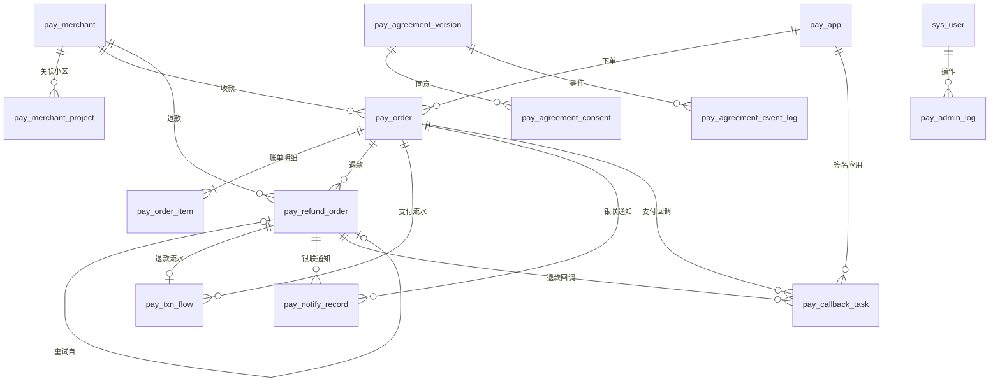

# paycenter 库表设计

> 首筑支付中心 v1.0 + 操作后台。技术栈 JeecgBoot 单体（jeecg-system-start），MySQL 8，需支持多实例部署。
> 主输入：`designs/v0/*/page.logic.md`（7 页）；辅输入：`paycenter/01` §7/§8、`02` §2–§3、`14` §6.2。
> 评审记录：`.apt/schema/progress.md`（8 个缺口逐项确认）。

## 变更摘要

- 新建表（14）：`pay_merchant`、`pay_merchant_project`、`pay_app`、`pay_channel_config`、`pay_order`、`pay_order_item`、`pay_refund_order`、`pay_txn_flow`、`pay_notify_record`、`pay_callback_task`、`pay_agreement_version`、`pay_agreement_consent`、`pay_agreement_event_log`、`pay_admin_log`
- 变更表：无（不改任何 JeecgBoot 框架表）
- 实体处置：
  - create：上述 14 张
  - reuse：`sys_user`（后台操作人）、`sys_dict` / `sys_dict_item`（业务字典）、`sys_quartz_job`（定时任务配置）、`sys_permission`（菜单与按钮权限）
  - 不建（二期）：`fee_rule`、`reconcile_task`、`reconcile_diff`
- 表名：统一 `pay_` 前缀；PRD 原名 `merchant` / `merchant_project` / `refund_order` / `txn_flow` / `user_agreement_consent` / `agreement_event_log` 分别改为 `pay_merchant` / `pay_merchant_project` / `pay_refund_order` / `pay_txn_flow` / `pay_agreement_consent` / `pay_agreement_event_log`

## 通用约定与豁免

### 主键与公共字段（对 `.apt/code-standards.md` 数据库节的豁免）

| 项 | 本设计 | code-standards | 豁免理由 |
|----|--------|----------------|----------|
| 主键 | `id VARCHAR(32)`，MyBatis-Plus ASSIGN_ID 雪花 | `id BIGINT` 自增 | JeecgBoot 实体基类、代码生成器、字典翻译均按字符串主键工作；多实例部署下雪花 ID 无冲突 |
| 审计字段 | `create_by` / `create_time` / `update_by` / `update_time` | `creator` / `created_at` / `updater` / `updated_at` | JeecgBoot 自动填充按这组字段名工作 |
| 逻辑删除 | `del_flag TINYINT(1)`，仅配置类表 | `deleted TINYINT(1)` | 同上；交易、流水、留痕、日志类表**只增不删**，不设删除标记 |
| 金额 | `BIGINT`，单位：分 | `DECIMAL` | 银联接口与内部 OpenAPI（02）均以分为单位的整数传输，避免换算误差；同样满足「禁止 FLOAT/DOUBLE」 |
| 物理删除 | 仅 `pay_merchant_project` | 禁止物理删除 | 为保证 `uk(project_id)`「一个小区只属于一个商户」成立；删除与变更写入 `pay_admin_log.diff` 可追溯 |

下文字段表里「公共字段」指：

| 字段名 | 类型 | 可空 | 说明 |
|--------|------|------|------|
| id | VARCHAR(32) | NO | 主键，雪花 ID |
| create_by | VARCHAR(32) | YES | 创建人（系统任务写 `system`） |
| create_time | DATETIME | NO | 创建时间 |
| update_by | VARCHAR(32) | YES | 更新人 |
| update_time | DATETIME | YES | 更新时间 |

### 状态更新与并发

- `pay_order`、`pay_refund_order`、`pay_callback_task` 带 `version INT` 乐观锁；所有状态迁移使用条件更新 `WHERE id=? AND status=?`，影响 0 行视为已被其他实例处理。
- 全额退款防重：发起退款时条件更新 `pay_order` `PAID → REFUNDING`，成功者才创建退款单。
- 终态（`REFUNDED` / `CLOSED` / `REFUND_SUCCESS` / `REFUND_FAIL`）不可再迁移。
- 不建表的部分：防重放 nonce 存 Redis（TTL 5 分钟）；定时任务互斥用 Redis 分布式锁；支付方式开关缓存 ≤30s。

### 密钥存储

- 所有密钥列以 `_enc` 结尾，AES-256-GCM 加密（随机 IV，密文含 IV 与 tag，Base64），配套 `key_version INT` 支持轮换。
- 主密钥只来自环境变量 `PAY_MASTER_KEY`，不入库、不入配置文件、不入日志。
- 不使用 JeecgBoot `AesEncryptUtil`（固定密钥 + CBC）。
- `pay_app.app_secret` 仅在创建或轮换时展示一次，之后任何接口不返回明文。

### 字典（复用 Jeecg `sys_dict`）

`pay_method`、`pay_order_status`、`refund_order_status`、`card_attr`、`bill_type`、`fee_bearer`、`agreement_code`、`agreement_source`、`pay_admin_log_action`、`yn`（Jeecg 内置），另新增 `callback_event`、`callback_task_status`、`notify_process_status`。

## 表清单

### 表 `pay_merchant`

- 表名：`pay_merchant`
- 处置：create
- 说明：商户（物业公司）配置。商户不提供删除，只能启用/停用。
- 主键：`id`
- 索引：`uk_pay_merchant_merchant_code`(merchant_code) / `idx_pay_merchant_merchant_name`(merchant_name)

| 字段名 | 类型 | 可空 | 说明 |
|--------|------|------|------|
| （公共字段） | — | — | 见通用约定 |
| merchant_code | VARCHAR(32) | NO | 商户编码，如 WY001；创建后不可改 |
| merchant_name | VARCHAR(128) | NO | 商户名称（物业公司全称） |
| unionpay_mchnt_no | VARCHAR(32) | YES | 银联主商户号；未下发时为空，列表只显示末 4 位 |
| unionpay_term_no | VARCHAR(32) | YES | 银联终端号 |
| wx_sub_appid | VARCHAR(64) | YES | 微信子商户 subAppId；为空时微信支付方式强制关闭 |
| callback_url | VARCHAR(512) | NO | 默认回调地址，https，域名须在 notify_domain 内 |
| notify_domain | VARCHAR(512) | NO | 回调域名白名单，英文逗号分隔 |
| pay_methods_enabled | VARCHAR(64) | NO | 已开启支付方式，逗号分隔：WECHAT,ALIPAY,UNIONPAY_CARD |
| max_amount | BIGINT | NO | 单笔限额（分），默认 5000000 |
| fee_bearer | VARCHAR(32) | YES | 手续费承担方，字典 fee_bearer |
| status | TINYINT(1) | NO | 1=启用 0=停用，默认 1；停用=拒绝新单 |
| remark | VARCHAR(512) | YES | 备注 |
| del_flag | TINYINT(1) | NO | 逻辑删除，默认 0（一期无删除入口） |

### 表 `pay_merchant_project`

- 表名：`pay_merchant_project`
- 处置：create
- 说明：商户-小区关联。小区主数据归 B 端物业系统，本表只存 ID 与名称快照；一期在商户弹窗手工录入，B 端小区接口接通后改为下拉选择。
- 主键：`id`
- 索引：`uk_pay_merchant_project_project_id`(project_id) / `idx_pay_merchant_project_merchant_id`(merchant_id)

| 字段名 | 类型 | 可空 | 说明 |
|--------|------|------|------|
| （公共字段） | — | — | 见通用约定；本表物理删除，无 del_flag |
| merchant_id | VARCHAR(32) | NO | 所属商户，→ pay_merchant.id |
| project_id | VARCHAR(64) | NO | 小区 ID（B 端物业系统） |
| project_name | VARCHAR(128) | NO | 小区名称快照 |
| unionpay_mchnt_no | VARCHAR(32) | YES | 小区独立银联商户号；为空则用商户主商户号 |
| unionpay_term_no | VARCHAR(32) | YES | 小区独立终端号；为空则用商户主终端号 |

### 表 `pay_app`

- 表名：`pay_app`
- 处置：create
- 说明：业务系统接入凭证（02 §3.1 获取访问令牌）。C 端 APP 与 B 端物业系统各一条或多条。
- 主键：`id`
- 索引：`uk_pay_app_app_id`(app_id)

| 字段名 | 类型 | 可空 | 说明 |
|--------|------|------|------|
| （公共字段） | — | — | 见通用约定 |
| app_id | VARCHAR(32) | NO | 应用标识，由支付中心分配 |
| app_name | VARCHAR(64) | NO | 应用名称 |
| app_type | VARCHAR(32) | NO | C_APP / B_SYSTEM |
| app_secret_enc | VARCHAR(512) | NO | app_secret 密文（AES-256-GCM）；用于令牌换取校验与回调 HMAC 签名 |
| key_version | INT | NO | 主密钥版本，默认 1 |
| allowed_merchant_ids | TEXT | YES | 允许操作的商户 ID，逗号分隔；为空=全部商户（假设：C 端 APP 面向全部商户，B 端系统可按物业公司限定） |
| status | TINYINT(1) | NO | 1=启用 0=停用 |
| secret_rotate_time | DATETIME | YES | 最近一次轮换密钥时间 |
| remark | VARCHAR(512) | YES | 备注 |
| del_flag | TINYINT(1) | NO | 逻辑删除，默认 0 |

### 表 `pay_channel_config`

- 表名：`pay_channel_config`
- 处置：create
- 说明：支付通道配置（一期仅银联商务）。一个部署环境一条有效记录。
- 主键：`id`
- 索引：`uk_pay_channel_config_channel_code`(channel_code)

| 字段名 | 类型 | 可空 | 说明 |
|--------|------|------|------|
| （公共字段） | — | — | 见通用约定 |
| channel_code | VARCHAR(32) | NO | 通道编码：UNIONPAY |
| env | VARCHAR(16) | NO | TEST / PROD |
| api_base_url | VARCHAR(512) | NO | 主域名 |
| backup_base_urls | TEXT | YES | 备用域名，逗号分隔（一期不做自动切换，预留） |
| app_id | VARCHAR(64) | NO | 银联开放平台 AppId（非密钥） |
| app_key_enc | VARCHAR(512) | NO | 银联 AppKey 密文，用于 OPEN-BODY-SIG |
| comm_key_enc | VARCHAR(512) | NO | 通讯密钥密文，用于异步通知验签 |
| msg_src | VARCHAR(64) | YES | 消息来源（银联分配） |
| msg_src_id | VARCHAR(8) | YES | 来源编号，商户订单号前缀 |
| notify_sign_type | VARCHAR(16) | NO | 通知签名算法，默认 SHA256 |
| key_version | INT | NO | 主密钥版本，默认 1 |
| connect_timeout_ms | INT | NO | 连接超时（毫秒），默认 3000 |
| read_timeout_ms | INT | NO | 读超时（毫秒），默认 10000 |
| rate_limit_tps | INT | NO | 出口限流（每秒请求数），默认 5 |
| status | TINYINT(1) | NO | 1=启用 0=停用 |
| remark | VARCHAR(512) | YES | 备注 |
| del_flag | TINYINT(1) | NO | 逻辑删除，默认 0 |

### 表 `pay_order`

- 表名：`pay_order`
- 处置：create
- 说明：支付单。状态见 01 §7 状态总表；`manual_check` 是标记不是状态。
- 主键：`id`
- 索引：`uk_pay_order_pay_order_no`(pay_order_no) / `uk_pay_order_merchant_biz`(merchant_id, biz_order_no) / `uk_pay_order_unionpay_order_id`(unionpay_order_id) / `idx_pay_order_create_time`(create_time) / `idx_pay_order_merchant_time`(merchant_id, create_time) / `idx_pay_order_status_query`(status, next_query_time) / `idx_pay_order_status_expire`(status, expire_time) / `idx_pay_order_manual_check`(manual_check, create_time)

| 字段名 | 类型 | 可空 | 说明 |
|--------|------|------|------|
| （公共字段） | — | — | 见通用约定；不设 del_flag |
| pay_order_no | VARCHAR(32) | NO | 支付单号（对外），如 P20260818000001 |
| merchant_id | VARCHAR(32) | NO | → pay_merchant.id |
| project_id | VARCHAR(64) | YES | 账单归属小区 |
| app_id | VARCHAR(32) | NO | 下单应用，→ pay_app.app_id |
| biz_order_no | VARCHAR(64) | NO | 业务单号，与 merchant_id 组成幂等键 |
| biz_user_id | VARCHAR(64) | NO | 业主标识 |
| total_amount | BIGINT | NO | 支付金额（分），服务端锁定 |
| refunded_amount | BIGINT | NO | 已退金额（分），默认 0 |
| pay_channel | VARCHAR(32) | NO | 通道：UNIONPAY |
| pay_method | VARCHAR(32) | NO | WECHAT / ALIPAY / UNIONPAY_CARD |
| card_attr | VARCHAR(16) | YES | DEBIT_CARD / CREDIT_CARD，银行卡交易由通知/查询回填 |
| status | VARCHAR(16) | NO | WAIT_PAY / PAID / REFUNDING / REFUNDED / CLOSED |
| unionpay_mchnt_no | VARCHAR(32) | NO | 下单时实际使用的银联商户号快照（退款/查单必须沿用） |
| unionpay_term_no | VARCHAR(32) | YES | 下单时实际使用的终端号快照 |
| unionpay_order_id | VARCHAR(64) | NO | 银联商户订单号 mchntOrderId |
| target_order_id | VARCHAR(64) | YES | 渠道订单号（微信/支付宝/银联侧） |
| target_sys | VARCHAR(32) | YES | 目标平台（银联返回 targetSys） |
| fee_amount | BIGINT | YES | 手续费（分），通知/查询回填 |
| settle_date | DATE | YES | 结算日，预留 |
| notify_url | VARCHAR(512) | NO | 本单回调地址（域名须在商户白名单内） |
| reserve | VARCHAR(512) | YES | 透传字段，回调原样带回 |
| expire_time | DATETIME | NO | 支付过期时间 |
| pay_time | DATETIME | YES | 银联支付成功时间 |
| notify_time | DATETIME | YES | 首次收到成功结果的时间（通知或查询） |
| close_time | DATETIME | YES | 关闭时间 |
| close_reason | VARCHAR(128) | YES | 关闭原因：超时 / 业务主动关闭 |
| division_flag | TINYINT(1) | NO | 分账标记，默认 0（预留） |
| sat_info | JSON | YES | 分账信息（预留） |
| version | INT | NO | 乐观锁，默认 0 |
| query_round | INT | NO | 定时查单已执行轮数，默认 0；满 3 轮未明确置 manual_check |
| next_query_time | DATETIME | YES | 下次查单时间（即时补查与定时任务共用） |
| last_query_time | DATETIME | YES | 上次查单时间 |
| manual_check | TINYINT(1) | NO | 需人工核查，默认 0 |
| manual_check_time | DATETIME | YES | 置位时间 |

### 表 `pay_order_item`

- 表名：`pay_order_item`
- 处置：create
- 说明：支付单账单明细；一期每单固定 1 条（02 约束 items 恰为 1），结构支持多条。
- 主键：`id`
- 索引：`idx_pay_order_item_pay_order_id`(pay_order_id) / `idx_pay_order_item_biz_bill_no`(biz_bill_no)

| 字段名 | 类型 | 可空 | 说明 |
|--------|------|------|------|
| id | VARCHAR(32) | NO | 主键 |
| pay_order_id | VARCHAR(32) | NO | → pay_order.id |
| biz_bill_no | VARCHAR(64) | NO | 业务账单号 |
| bill_type | VARCHAR(32) | NO | 字典 bill_type：PROPERTY_FEE / PARKING_MONTHLY |
| amount | BIGINT | NO | 金额（分） |
| billed_period | VARCHAR(32) | YES | 账期，如 2026-07 |
| create_time | DATETIME | NO | 创建时间 |

### 表 `pay_refund_order`

- 表名：`pay_refund_order`
- 处置：create
- 说明：退款单。一期全额退款；失败后「重试」= 新建退款单并以 retry_of 指向原失败单。
- 主键：`id`
- 索引：`uk_pay_refund_order_refund_order_no`(refund_order_no) / `uk_pay_refund_order_merchant_biz`(merchant_id, biz_refund_no) / `uk_pay_refund_order_unionpay_refund_id`(unionpay_refund_order_id) / `idx_pay_refund_order_pay_order_id`(pay_order_id) / `idx_pay_refund_order_create_time`(create_time) / `idx_pay_refund_order_status_query`(status, next_query_time) / `idx_pay_refund_order_manual_check`(manual_check, create_time)

| 字段名 | 类型 | 可空 | 说明 |
|--------|------|------|------|
| （公共字段） | — | — | 见通用约定；不设 del_flag |
| refund_order_no | VARCHAR(32) | NO | 退款单号（对外），如 R20260818000001 |
| pay_order_id | VARCHAR(32) | NO | → pay_order.id |
| pay_order_no | VARCHAR(32) | NO | 原支付单号快照（列表与检索用） |
| merchant_id | VARCHAR(32) | NO | → pay_merchant.id |
| source | VARCHAR(16) | NO | ADMIN（后台发起）/ API（业务系统发起） |
| app_id | VARCHAR(32) | YES | API 发起时的应用 |
| biz_refund_no | VARCHAR(64) | NO | 业务退款号，与 merchant_id 组成幂等键；后台发起时系统生成 |
| refund_amount | BIGINT | NO | 退款金额（分），一期 = 原单 total_amount |
| status | VARCHAR(16) | NO | REFUNDING / REFUND_SUCCESS / REFUND_FAIL |
| unionpay_refund_order_id | VARCHAR(64) | NO | 发给银联的退款订单号 refundOrderId |
| channel_refund_id | VARCHAR(64) | YES | 银联退货单号（refundTargetOrderId） |
| refund_time | DATETIME | YES | 退款完成时间 |
| fail_reason | VARCHAR(256) | YES | 失败原因（如可用余额不足） |
| reason | VARCHAR(256) | NO | 退款原因（≤200 字） |
| reviewer | VARCHAR(64) | YES | 发起人 / 审核人 |
| review_status | VARCHAR(16) | YES | 审核状态（预留，一期为空） |
| notify_url | VARCHAR(512) | YES | API 发起时的回调地址 |
| refund_fee_return | BIGINT | YES | 退还手续费（分），预留 |
| refund_seq | INT | NO | 第几次退款，默认 1（部分退款预留） |
| retry_of | VARCHAR(32) | YES | 重试来源的原失败退款单 id |
| version | INT | NO | 乐观锁，默认 0 |
| query_round | INT | NO | 定时查单轮数，默认 0 |
| next_query_time | DATETIME | YES | 下次查单时间 |
| last_query_time | DATETIME | YES | 上次查单时间 |
| manual_check | TINYINT(1) | NO | 需人工核查，默认 0 |
| manual_check_time | DATETIME | YES | 置位时间 |

### 表 `pay_txn_flow`

- 表名：`pay_txn_flow`
- 处置：create
- 说明：交易流水，只增不改；二期对账/结算的数据根基。每笔成功支付、每笔退款结果各一条。
- 主键：`id`
- 索引：`uk_pay_txn_flow_flow_no`(flow_no) / `uk_pay_txn_flow_type_biz`(type, biz_id) / `idx_pay_txn_flow_pay_order_id`(pay_order_id) / `idx_pay_txn_flow_channel_seq`(channel_seq) / `idx_pay_txn_flow_txn_time`(txn_time)

| 字段名 | 类型 | 可空 | 说明 |
|--------|------|------|------|
| id | VARCHAR(32) | NO | 主键 |
| flow_no | VARCHAR(32) | NO | 流水号 |
| type | VARCHAR(16) | NO | PAY / REFUND |
| biz_id | VARCHAR(32) | NO | PAY=pay_order.id，REFUND=pay_refund_order.id；与 type 组成唯一键防重复入账 |
| pay_order_id | VARCHAR(32) | NO | → pay_order.id |
| refund_order_id | VARCHAR(32) | YES | → pay_refund_order.id |
| merchant_id | VARCHAR(32) | NO | → pay_merchant.id |
| amount | BIGINT | NO | 金额（分） |
| fee_amount | BIGINT | YES | 手续费（分） |
| card_attr | VARCHAR(16) | YES | 卡种（费率依据） |
| status | VARCHAR(16) | NO | SUCCESS / FAIL |
| channel_seq | VARCHAR(64) | YES | 银联流水号 |
| settle_date | DATE | YES | 结算日期 |
| txn_time | DATETIME | NO | 渠道交易时间 |
| source | VARCHAR(16) | NO | NOTIFY / QUERY（结果来源） |
| create_by | VARCHAR(32) | YES | 创建人（system） |
| create_time | DATETIME | NO | 创建时间 |

### 表 `pay_notify_record`

- 表名：`pay_notify_record`
- 处置：create
- 说明：银联异步通知记录，只增不改；按 notify_id 去重；验签失败的通知同样记录。
- 主键：`id`
- 索引：`uk_pay_notify_record_notify_id`(notify_id) / `idx_pay_notify_record_mchnt_order_id`(mchnt_order_id) / `idx_pay_notify_record_receive_time`(receive_time)

| 字段名 | 类型 | 可空 | 说明 |
|--------|------|------|------|
| id | VARCHAR(32) | NO | 主键 |
| notify_id | VARCHAR(64) | YES | 银联 notifyId（异常报文可能缺失） |
| msg_type | VARCHAR(64) | YES | 通知类型 |
| mchnt_order_id | VARCHAR(64) | YES | 商户订单号 |
| refund_order_id | VARCHAR(64) | YES | 退款订单号（TRADE_REFUND 类通知） |
| sign_type | VARCHAR(16) | YES | 报文 signType |
| sign_valid | TINYINT(1) | NO | 验签是否通过 |
| raw_body | TEXT | NO | 原始报文 |
| client_ip | VARCHAR(45) | YES | 来源 IP（对照 15 个银商出口 IP） |
| process_status | VARCHAR(16) | NO | PROCESSED / IGNORED / ERROR |
| process_result | VARCHAR(512) | YES | 处理说明 |
| pay_order_id | VARCHAR(32) | YES | 匹配到的支付单 |
| refund_id | VARCHAR(32) | YES | 匹配到的退款单 |
| trace_id | VARCHAR(64) | YES | 链路追踪 ID |
| receive_time | DATETIME | NO | 收到时间 |
| process_time | DATETIME | YES | 处理完成时间 |
| create_time | DATETIME | NO | 创建时间 |

### 表 `pay_callback_task`

- 表名：`pay_callback_task`
- 处置：create
- 说明：回调业务系统的推送任务。失败按 1/2/4/8/16 分钟退避重试 5 次，仍失败置 FAILED + manual_check 并告警；后台手动重推为二期。
- 主键：`id`
- 索引：`uk_pay_callback_task_biz_event`(biz_type, biz_id, event) / `idx_pay_callback_task_status_retry`(status, next_retry_time)

| 字段名 | 类型 | 可空 | 说明 |
|--------|------|------|------|
| （公共字段） | — | — | 见通用约定；不设 del_flag |
| biz_type | VARCHAR(16) | NO | PAY / REFUND |
| biz_id | VARCHAR(32) | NO | pay_order.id 或 pay_refund_order.id |
| biz_no | VARCHAR(32) | NO | 对外单号快照 |
| event | VARCHAR(32) | NO | PAY_SUCCESS / PAY_CLOSED / REFUND_SUCCESS / REFUND_FAIL |
| merchant_id | VARCHAR(32) | NO | → pay_merchant.id |
| app_id | VARCHAR(32) | YES | 签名所用应用（取其 app_secret） |
| notify_url | VARCHAR(512) | NO | 推送地址 |
| payload | TEXT | NO | 推送报文原文（不含密钥），每次重试相同；签名头每次现算 |
| status | VARCHAR(16) | NO | PENDING / SUCCESS / FAILED |
| retry_count | INT | NO | 已推送次数，默认 0 |
| max_retry | INT | NO | 最大重试次数，默认 5 |
| next_retry_time | DATETIME | YES | 下次推送时间 |
| last_push_time | DATETIME | YES | 最近推送时间 |
| last_http_status | INT | YES | 最近 HTTP 状态码 |
| last_response | VARCHAR(512) | YES | 最近响应（截断 512） |
| last_error | VARCHAR(512) | YES | 最近异常信息 |
| manual_check | TINYINT(1) | NO | 需人工核查，默认 0 |
| trace_id | VARCHAR(64) | YES | 链路追踪 ID |
| version | INT | NO | 乐观锁，默认 0 |

### 表 `pay_agreement_version`

- 表名：`pay_agreement_version`
- 处置：create
- 说明：协议版本配置。当前版本 = 同一 agreement_code 下 status=1 且 effective_time ≤ 当前时间、effective_time 最晚的一条；不设「是否当前」标记。一期初始化 SQL 写入 5 份 v1.0。
- 主键：`id`
- 索引：`uk_pay_agreement_version_code_version`(agreement_code, version) / `idx_pay_agreement_version_code_effective`(agreement_code, effective_time)

| 字段名 | 类型 | 可空 | 说明 |
|--------|------|------|------|
| （公共字段） | — | — | 见通用约定 |
| agreement_code | VARCHAR(32) | NO | 字典 agreement_code：USER_SERVICE / PRIVACY / PAY_SERVICE / FEE_NOTICE / REFUND_RULE |
| version | VARCHAR(16) | NO | 版本号，如 v1.0 |
| title | VARCHAR(128) | NO | 协议标题 |
| content_url | VARCHAR(512) | NO | 协议全文 URL |
| effective_time | DATETIME | NO | 生效时间 |
| status | TINYINT(1) | NO | 1=启用 0=停用 |
| remark | VARCHAR(512) | YES | 变更说明 |
| del_flag | TINYINT(1) | NO | 逻辑删除，默认 0 |

### 表 `pay_agreement_consent`

- 表名：`pay_agreement_consent`
- 处置：create
- 说明：协议同意记录（14 §6.2 表 1），法律证据，**永久保留**、只增不改；同一 (user_id, agreement_code, version) 重复提交幂等。手机号不入本表，查询时关联用户系统并脱敏。
- 主键：`id`
- 索引：`uk_pay_agreement_consent_user_code_version`(user_id, agreement_code, version) / `idx_pay_agreement_consent_user_id`(user_id) / `idx_pay_agreement_consent_agreement_code`(agreement_code)

| 字段名 | 类型 | 可空 | 说明 |
|--------|------|------|------|
| id | VARCHAR(32) | NO | 主键 |
| user_id | VARCHAR(64) | NO | 业主标识 |
| agreement_code | VARCHAR(32) | NO | 协议编码 |
| version | VARCHAR(16) | NO | 协议版本 |
| consent_time | DATETIME | NO | 同意时间（服务端生成，权威时间） |
| source | VARCHAR(32) | NO | 字典 agreement_source：LOGIN / PAY_APP / BILL_PAGE / REFUND |
| client_ip | VARCHAR(45) | YES | 客户端 IP |
| device_id | VARCHAR(64) | YES | 设备标识 |
| create_time | DATETIME | NO | 创建时间 |
| update_time | DATETIME | YES | 更新时间 |

### 表 `pay_agreement_event_log`

- 表名：`pay_agreement_event_log`
- 处置：create
- 说明：协议曝光/查看/同意/拒绝事件流水（14 §6.2 表 2），保留 ≥5 年。
- 主键：`id`
- 索引：`idx_pay_agreement_event_log_create_time`(create_time) / `idx_pay_agreement_event_log_user_id`(user_id)

| 字段名 | 类型 | 可空 | 说明 |
|--------|------|------|------|
| id | VARCHAR(32) | NO | 主键 |
| event | VARCHAR(32) | NO | expose / click_view / consent / reject |
| user_id | VARCHAR(64) | NO | 业主标识 |
| agreement_code | VARCHAR(32) | NO | 协议编码 |
| version | VARCHAR(16) | NO | 协议版本 |
| entry | VARCHAR(32) | YES | 触达入口 |
| source | VARCHAR(32) | YES | 来源 |
| client_ip | VARCHAR(45) | YES | 客户端 IP |
| device_id | VARCHAR(64) | YES | 设备标识 |
| create_time | DATETIME | NO | 创建时间 |

### 表 `pay_admin_log`

- 表名：`pay_admin_log`
- 处置：create
- 说明：操作后台业务操作日志（P7），只增不改，保留 ≥5 年；不改 Jeecg `sys_log`。登录成功也写一条 LOGIN。
- 主键：`id`
- 索引：`idx_pay_admin_log_create_time`(create_time) / `idx_pay_admin_log_action_time`(action, create_time) / `idx_pay_admin_log_operator_name`(operator_name) / `idx_pay_admin_log_target_id`(target_id)

| 字段名 | 类型 | 可空 | 说明 |
|--------|------|------|------|
| id | VARCHAR(32) | NO | 主键 |
| operator_id | VARCHAR(32) | NO | 操作人，→ sys_user.id |
| operator_name | VARCHAR(64) | NO | 操作人账号/姓名快照 |
| action | VARCHAR(32) | NO | 字典 pay_admin_log_action：LOGIN / MCH_ADD / MCH_EDIT / MCH_TOGGLE / SWITCH_CHANGE / LIMIT_CHANGE / REFUND_CREATE / REFUND_RETRY / AGREEMENT_CONFIG |
| target_type | VARCHAR(32) | YES | MERCHANT / REFUND_ORDER / AGREEMENT 等 |
| target_id | VARCHAR(64) | YES | 对象 ID 或单号 |
| target_name | VARCHAR(128) | YES | 对象展示名，如「WY001 重庆龙湖物业」 |
| diff | JSON | YES | 字段级变更 before→after；不得包含密钥明文 |
| ip | VARCHAR(45) | NO | 操作 IP |
| trace_id | VARCHAR(64) | YES | 链路追踪 ID |
| create_time | DATETIME | NO | 操作时间 |

## 关系

| from | to | kind |
|------|----|------|
| pay_merchant_project | pay_merchant | many-to-one |
| pay_order | pay_merchant | many-to-one |
| pay_order | pay_app | many-to-one |
| pay_order_item | pay_order | many-to-one |
| pay_refund_order | pay_order | many-to-one |
| pay_refund_order | pay_merchant | many-to-one |
| pay_refund_order | pay_refund_order | many-to-one |
| pay_txn_flow | pay_order | many-to-one |
| pay_txn_flow | pay_refund_order | many-to-one |
| pay_notify_record | pay_order | many-to-one |
| pay_notify_record | pay_refund_order | many-to-one |
| pay_callback_task | pay_order | many-to-one |
| pay_callback_task | pay_refund_order | many-to-one |
| pay_callback_task | pay_app | many-to-one |
| pay_agreement_consent | pay_agreement_version | many-to-one |
| pay_agreement_event_log | pay_agreement_version | many-to-one |
| pay_admin_log | sys_user | many-to-one |

> 说明：均为逻辑关联，不建数据库外键（JeecgBoot 惯例，且便于分表归档）；`pay_agreement_*` 与版本表按 (agreement_code, version) 关联；`pay_callback_task` / `pay_txn_flow` 按 biz_type/type 指向支付单或退款单。

## E-R

## 页面字段覆盖核对

| 页面 | 主要数据来源 | 覆盖情况 |
|------|--------------|----------|
| 登录 login | sys_user（Jeecg）+ pay_admin_log(LOGIN) | 覆盖；失败锁定复用 Jeecg |
| 工作台 dashboard | pay_order / pay_refund_order 聚合（今日成功、今日退款、待处理退款、需人工核查） | 覆盖，依赖 create_time / status / manual_check 索引 |
| 商户管理 merchants | pay_merchant + pay_merchant_project | 覆盖（含末 4 位商户号、3 开关、限额、关联小区） |
| 交易查询 trades | pay_order + pay_order_item + pay_refund_order + pay_txn_flow | 覆盖（含 card_attr、refunded_amount、manual_check、channel_seq、fee_amount、settle_date） |
| 退款处理 refunds | pay_refund_order + pay_order | 覆盖（含 channel_refund_id、refund_time、reviewer、fail_reason、重试） |
| 协议留痕 agreements | pay_agreement_consent（手机号外部关联脱敏） | 覆盖 |
| 操作日志 logs | pay_admin_log | 覆盖（操作人/动作/对象/diff/时间/IP） |
